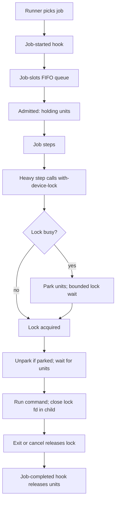
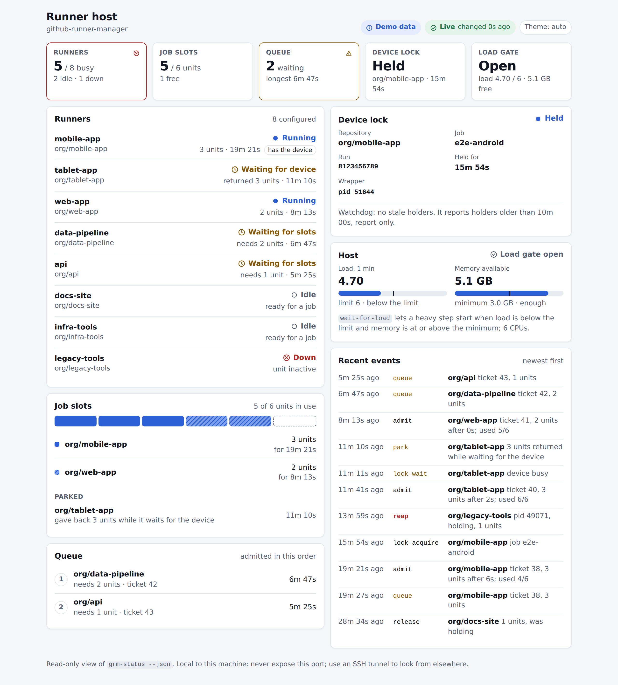

# github-runner-manager

Several repositories, one modest Linux machine, and heavy jobs arriving together:
Android emulators compete for one device, native builds exhaust available memory,
and CPU contention makes emulator tests flaky. Repository-local scheduling cannot
coordinate the host.

This toolkit adds small, inspectable Bash gates around manually registered GitHub
Actions runners. Slot weights are operator estimates, not measured resource costs.

- One runner per repository, managed by a systemd user unit.
- Host-wide weighted FIFO job slots, acquired and released by runner job hooks.
- An exclusive device lock whose descriptor never reaches commands or descendants.
  Cancellation forwards TERM, INT, or HUP and keeps the lock until the command stops, with a
  bounded grace period.
- Slot parking while waiting for the device, then priority when requesting slots back.
- Optional load and available-memory waits before heavy steps.
- A report-only stale-lock watchdog, with opt-in allow-listed termination.
- Repository workflow concurrency rules to cancel superseded runs.



## Quick start

Requires Linux, Bash 4.4+, coreutils, awk, util-linux `flock`, a systemd user
manager, and `pgrep` for the status display. No daemon or package installation is
provided. Keep the toolkit in a stable absolute location, such as
`$HOME/github-runner-manager`. All participating runners must share the config,
state directory, device lock, and user account. Use a local filesystem.

1. Copy and edit configuration:

   ```bash
   cp config.example.env config.env
   ```

2. Download and register each runner by hand into `$GRM_RUNNERS_DIR/<name>`,
   following [GitHub's runner instructions](https://docs.github.com/en/actions/hosting-your-own-runners/managing-self-hosted-runners/adding-self-hosted-runners).
   Set the labels in registration; the labels in `GRM_RUNNERS` are informational.
   The toolkit never handles registration or removal tokens.
3. Install the unit and wire both job hooks into the runner's `.env`:

   ```bash
   bin/grm-install-runner --enable --watchdog repo-a
   bin/grm-install-runner --enable repo-b
   ```

   Existing active runners need an operator restart when idle to load `.env`
   changes. Installation never restarts one implicitly. A user manager may need
   lingering enabled by the operator to run after logout.
4. Use the wrappers in consumer workflows:

   ```bash
   GRM_HOME="$HOME/github-runner-manager"
   "$GRM_HOME/bin/wait-for-load"
   exec "$GRM_HOME/bin/with-device-lock" -- ./scripts/run-emulator-tests.sh
   ```

   Slots apply to the whole job through runner hooks. See the complete
   [consumer workflow](docs/consumer-workflow.md).
5. Inspect with `bin/grm-status` (`--watch` to keep it on screen, `--json` for
   the [machine-readable form](docs/status-json.md)). Remove management with
   `bin/grm-uninstall-runner repo-a`; registration and runner files remain.

Configuration is sourced Bash: trust it like executable code. Exported `GRM_*`
variables override file values; file values override defaults. The default file
is `config.env` beside this README; `GRM_CONFIG` selects another file. See
[config.example.env](config.example.env) for every operator setting. Use absolute
paths. The install reserves four `.env` keys: both `ACTIONS_RUNNER_HOOK_JOB_*`
keys, `GRM_JOB_UNITS`, and `GRM_CONFIG`.

## Dashboard



A local, read-only page for keeping an eye on the host: runners, slot pool,
queue, device lock, load gate and recent events, updating as they change. Try it
with invented data, without configuring anything:

```bash
bin/grm-dashboard --demo   # then open http://127.0.0.1:4290
```

It is a small Phoenix LiveView app in `dashboard/` and needs Elixir; without it,
`bin/grm-status --watch` shows the same state in the terminal. It listens on
127.0.0.1 only and has no authentication: never expose the port, use an SSH
tunnel (`ssh -L 4290:127.0.0.1:4290 user@host`) to look from elsewhere. Design,
security and trade-offs: [docs/dashboard.md](docs/dashboard.md).

## Design and limits

[Job slots](docs/job-slots.md) bound admitted weights, not CPU or memory usage.
After the maximum wait they warn and admit, retaining overcommit in accounting.
A request larger than capacity can enter alone when the pool is empty. The device
lock instead fails on timeout. Load waits default to warning and proceeding.
These are admission controls, not hard resource isolation or a security boundary.

[Device locking](docs/device-lock.md) prevents inherited-descriptor leaks. SIGKILL
of the wrapper can still release a lock while its command runs. Commands must
manage their own descendant shutdown; the runner's orphan cleanup and
[watchdog](docs/watchdog.md) are additional defences, not guarantees. Never delete
or replace a live lock file: that creates separate lock domains.

[Runner units](docs/runner-units.md), [load waits](docs/wait-for-load.md), and
[concurrency](docs/concurrency.md) explain the remaining mechanisms.

Alternatives considered:

| Alternative | Trade-off |
| --- | --- |
| Bigger machine | More headroom costs more and still does not make one emulator device shareable. |
| GitHub-hosted runners | Prefer them when practical. Emulator acceleration depends on runner type and plan; cost and cache transport can favour a persistent host. Do not assume KVM availability. |
| Ephemeral runners / Actions Runner Controller | Good at scale; lifecycle automation and Kubernetes add operations beyond a small host. |
| One runner with all labels | Serialises all jobs. Repository runners cannot span personal repositories; organisation runners provide broader sharing. |
| GitHub concurrency groups | Useful within one repository, with no ordering across repositories. |

## Security

Never attach a self-hosted runner to a public repository: fork pull requests can
run arbitrary code on the machine. This toolkit's own CI uses GitHub-hosted
runners only. Use private, trusted consumer repositories and treat workflow code
as local code execution. Registration tokens are secret and short-lived. Runners
run as their user; prefer a separate account with minimal access. Slots and locks
do not protect against malicious jobs.

## Status

First version. The suite covers unit and process-level behaviour: FIFO/weighted
admission, concurrent acquirers, PID reuse and crash reaping, parking, inherited
lock descriptors, cancellation and grace periods, load waits, watchdog policy,
unit rendering and `.env` preservation. systemctl is stubbed. CI is configured to
run these tests on a GitHub-hosted Ubuntu VM; configuration is not evidence that
a CI run has passed.

The cancellation path with `exec` is not verified on a real runner.

The dashboard has its own ExUnit suite (parsing, derived values, the poller, the
page in its main states) and a smoke test of the running server. It has been
exercised with demo data and stubbed status commands only, not on a host with
real runners.

Not tested: real runners and GitHub job hooks, real emulators or adb, systemd
itself, real memory pressure, or multi-day operation. No performance measurements
are claimed. Validate on a disposable host before depending on it.

```bash
scripts/fetch-test-deps.sh # Network required only if the pinned bats is absent.
test/vendor/bats-core/bin/bats test/
shellcheck bin/* hooks/* lib/*.sh scripts/*.sh test/*.bash
(cd dashboard && mix deps.get && mix check) # Needs Elixir; see dashboard/.tool-versions.
```

## Keeping private details out

Keep your own private-term list outside the repository. Each nonblank,
non-comment line is a case-insensitive extended regular expression. Point
`PRIVATE_TERMS_FILE` at it and use `scripts/check-no-private-terms.sh --worktree`
locally. Installed as a pre-push hook, the script checks outgoing commit trees,
messages, author/committer names, and ref names. Protect the list itself; do not
commit it. Without the variable the script prints a no-op notice, including in CI.
The checker is a backstop; keep examples generic before committing.

MIT; see [LICENSE](LICENSE).
