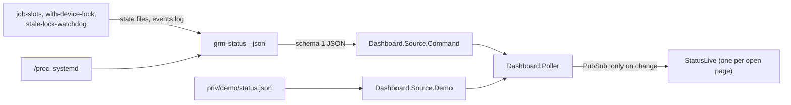
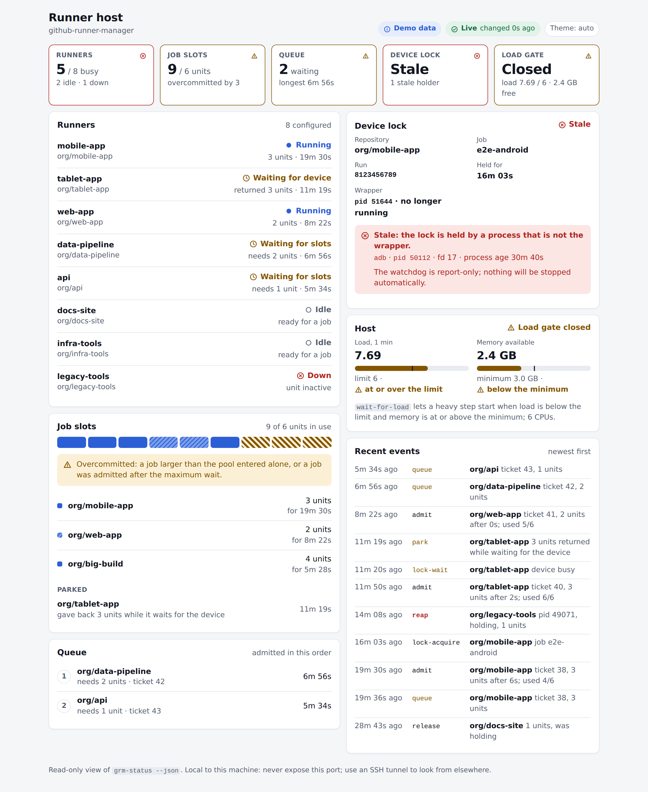
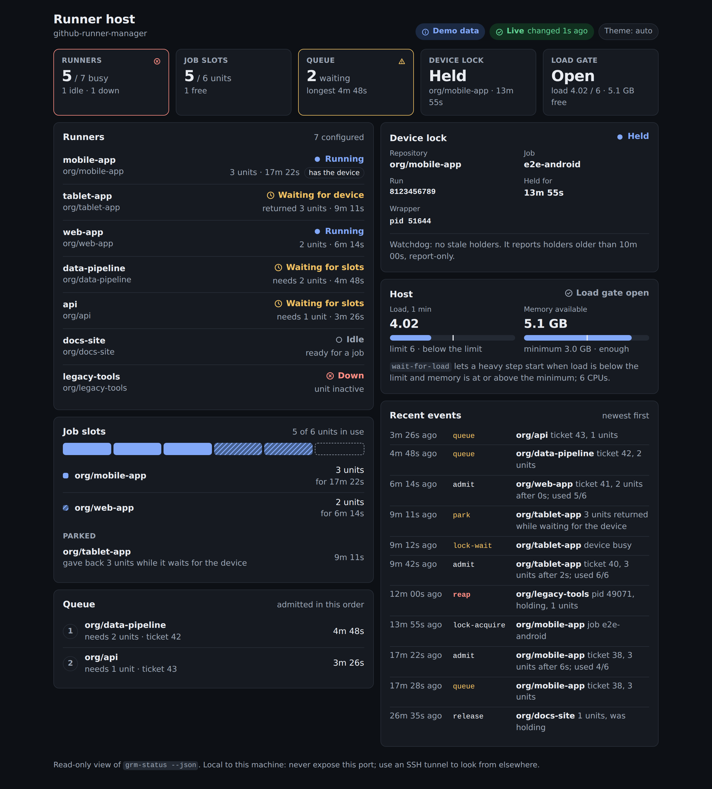

# Dashboard

A local, read-only web page that answers at a glance what the gates are doing:
which runners are up, busy or idle; how full the slot pool is and who holds how
many units; who is waiting, in admission order, and for how long; who has the
device lock, for how long, and whether the watchdog considers it stale; load and
memory against the gate thresholds; and the most recent events.


All data in the screenshots is the bundled demo reading, which is invented.

```bash
bin/grm-dashboard --demo      # invented data, nothing on the host is read
bin/grm-dashboard             # this host, through grm-status --json
bin/grm-dashboard --port 4300 # default port is 4290 (or GRM_DASHBOARD_PORT)
```

Then open <http://127.0.0.1:4290>. The first start fetches the Hex packages
(network) and compiles; later starts take a few seconds.

## Cost, and the fallback

The dashboard is the one part of this toolkit that needs more than Bash: Erlang
and Elixir, at the versions in `dashboard/.tool-versions`. Nothing else depends
on it, and it changes no state. Without Elixir the same information is available
in the terminal:

```bash
bin/grm-status --watch   # the text view, repeated every 2 seconds
bin/grm-status --json    # the document the dashboard reads
```

## Security

Without a viewer list the dashboard asks no login, so it must stay local; with
one, served to a private network, only listed viewers see it, from anywhere.

- The endpoint binds 127.0.0.1 only; there is no option to bind anything else.
- **Never expose the port**: no port forward, no `0.0.0.0`, no public reverse
  proxy or tunnel. To look from another machine use an SSH tunnel, which keeps
  the request local on the host: `ssh -L 4290:127.0.0.1:4290 user@host`, then
  open `http://localhost:4290` on your side. To look from a phone, use a
  private-network proxy on the same machine: [remote-access.md](remote-access.md).
- Requests whose `Host` header is not `localhost` or `127.0.0.1` get a 403.
  Without that check, a web page open in a browser on the host could reach the
  loopback port through DNS rebinding.
- The WebSocket accepts pages from the same two names only (`check_origin`).
- More names can be allowed, exactly and one by one, with `--allow-host` or
  `GRM_DASHBOARD_ALLOWED_HOSTS`, for the private-network proxy above. One list
  (`DashboardWeb.AllowedHosts`) feeds the `Host` check, the socket origin check
  and the content security policy. Forwarded headers are never read.
- An extra name needs a viewer list (`--viewer` or `GRM_DASHBOARD_VIEWERS`):
  the identities the private-network proxy names in its identity header.
  Without one the dashboard refuses to start. With one, every request needs a
  listed identity, loopback ones included, and the live socket checks the
  signed session again when it connects. Details and limits, including what a
  process on this machine can still do:
  [remote-access.md](remote-access.md#viewers).
- At most 4 acceptors with 32 connections each; a phone and a laptop need a
  handful.
- The page is view-only by construction: it handles no events from the
  browser, has no forms and no parameters, and a test flags the usual ways
  that would change.
  The status command is started with a fixed argument vector from
  configuration; nothing a request carries can reach it.
- A content security policy allows scripts and styles from the dashboard itself
  only, with no inline code. Values from the status document are escaped by the
  templates.
- It is read-only. `grm-status --json` creates no state, never probes the device
  lock, and never signals a process; the dashboard only runs that command.

What it shows is still information about the host (repository names, job names,
process ids), which is one more reason to keep it local. Every job on the host
can read the same information directly while runners and the dashboard share
an account: see [runner-units.md](runner-units.md#separate-accounts).

## How it works



**The seam is `grm-status --json`** ([schema](status-json.md)). The dashboard
knows nothing about state files, locks or `/proc`; the Bash side knows nothing
about the dashboard. The schema is versioned and the Elixir side rejects a
version it does not know instead of guessing.

| Module | Job |
| --- | --- |
| `Dashboard.Source` | Behaviour for "read the host once". `Source.Command` runs the status command under `timeout`; `Source.Demo` replays the bundled reading. |
| `Dashboard.Status` | Parses the document into structs at the boundary. A wrong type or missing field is an error naming the field. Enumerated values map through explicit clauses; no atoms are created from input. |
| `Dashboard.Overview` | Pure functions for everything derived: runner activity, pool use, queue order, waits, lock condition, load gate, formatting. `now` is always an argument. |
| `Dashboard.Snapshot` | The latest reading plus whether reading currently fails, and since when. |
| `Dashboard.Poller` | The one long-lived process: owns the timer, the last good reading and the failure count. |
| `DashboardWeb.StatusLive` | Subscribes to the poller's topic; renders function components from `StatusComponents`. |

Supervision is `rest_for_one` in dependency order: PubSub, a task supervisor,
the poller, the endpoint. Each read runs as a supervised task, so a slow or
crashing status command neither blocks page loads nor takes the poller down.

**Refresh.** The poller reads every 2 seconds (`GRM_DASHBOARD_INTERVAL_MS`) and
broadcasts only when the picture differs from the previous one, ignoring the
document's own timestamp. Pages keep a one-second clock of their own, so waits
and hold times count up between readings without any message from the server
side of the gates. One reading serves every open page.

**When reading fails** the last good reading stays on screen under a "stale
data" notice that says how old it is and why reading failed; retries back off
exponentially to 30 seconds and return to the normal interval on the first
success. If no reading has ever succeeded the page says so and shows no cards.
If the browser loses the dashboard itself, the page says it is disconnected.

**Demo mode** serves `dashboard/priv/demo/status.json` re-based to the current
time on a ten-minute loop, with a little drift in the load figure so the page
visibly updates. The same file is the fixture for the ExUnit tests, and a bats
test checks that it has exactly the shape real `--json` output has.

### Polling, not file watching

Watching the state directory looks cheaper but would miss most of what the page
shows. Load and memory come from `/proc`. Whether a holder is still alive is
process state: a crashed job changes no file until the next gate command reaps
it. Runner state is systemd's. Wait times change with the clock. A watcher would
therefore need a timer as well, plus a dependency and its platform quirks, to
save one short command every two seconds. Polling a single command also keeps
the seam in one place.

### Why LiveView

| Option | Trade-off |
| --- | --- |
| LiveView (chosen) | Server-rendered and pushed on change, so the page never shows a half-updated picture and needs no client code of its own. One read serves all pages. State parsing and derived values are plain, testable Elixir. Costs an Elixir toolchain on the host. |
| Static page polling the JSON | Smallest footprint and no toolchain, but still needs something to serve the JSON locally, moves all derivation into untested browser script, and each open page polls on its own. |
| Terminal UI | No browser needed; poor on a phone over a tunnel, and no better than `grm-status --watch`, which already exists. |
| Prometheus and Grafana | Right for history and alerting across hosts. Two more services to run and secure on a modest machine, and a queue in admission order or a lock holder is awkward as time series. |

### Dependencies

| Package | Why |
| --- | --- |
| `phoenix`, `phoenix_live_view`, `phoenix_html` | The web layer and its templates. |
| `bandit` | The HTTP server. |
| `jason` | JSON decoding. |
| `lazy_html` (tests only) | Required by `Phoenix.LiveViewTest`. |

There is no database, mailer, translation layer or asset pipeline. The
stylesheet is one hand-written file and the LiveView client is served as
shipped inside the Hex packages, so there is no Node, bundler or CSS toolchain
to install and nothing to download at build time beyond Hex packages.

## Reading the page

Every status is written out and has its own icon shape; colour only reinforces
it. Light and dark follow the system setting, and the button in the header
overrides it.

- **Runners**: *Running* (a job holds units, or runs outside the slot gate),
  *Waiting for slots* (queued), *Waiting for device* (parked: it gave its units
  back while another job has the device), *Idle*, *Down* (the unit is not
  active). A runner is matched to its job through the job worker's process id.
- **Job slots**: one cell per unit; hatched cells past capacity mean the pool is
  overcommitted, which the gate allows for an oversized job running alone and
  for anyone past the maximum wait.
- **Queue**: the order the gate will admit, with how long each job has waited.
- **Device lock**: *Held* by a live wrapper; *Unclaimed* when it is held but the
  recorded wrapper is gone; *Stale* when the watchdog reports a holder. The
  dashboard never stops anything; it shows what the watchdog would do.
- **Host**: the threshold is the mark at mid-scale on both meters.



| Dark | Phone |
| --- | --- |
|  |  |

## Running it permanently

`systemd/grm-dashboard.service.in` is a template for a systemd user unit; the
comment at its top has the commands. Nothing installs it for you. The service
runs a built release, never the source: build it once, and again after each
update of the checkout:

```bash
cd dashboard && mix deps.get --only prod && MIX_ENV=prod mix release
```

The unit sets `GRM_DASHBOARD_RELEASE_ONLY=1`, which makes the launcher stop
with a message instead of fetching packages over the network and compiling
whatever is in the checkout at each start. The unit also caps memory and
tasks. A built release always wins over the source for `bin/grm-dashboard` run
by hand too. If the checkout path contains spaces, quote it in the unit's
`ExecStart`.

## Development

```bash
cd dashboard
mix deps.get
mix check          # format check, compile with warnings as errors, tests
```

`test/dashboard.bats` covers the launcher without Elixir.
`test/dashboard-smoke.bats` starts the real server in demo mode and checks that
it listens on 127.0.0.1 only, serves the page, refuses path traversal and
foreign `Host` headers, answers to one extra allowed name, completes a WebSocket
handshake for allowed origins only, and exits on TERM; it is skipped where
Elixir is absent.

## Not verified

The dashboard has been exercised with demo data, with stubbed status commands,
and against `grm-status --json` under the bats suite's stubs. It has not been
run against a host with real runners, real systemd units or a real device lock,
nor for days at a time.
