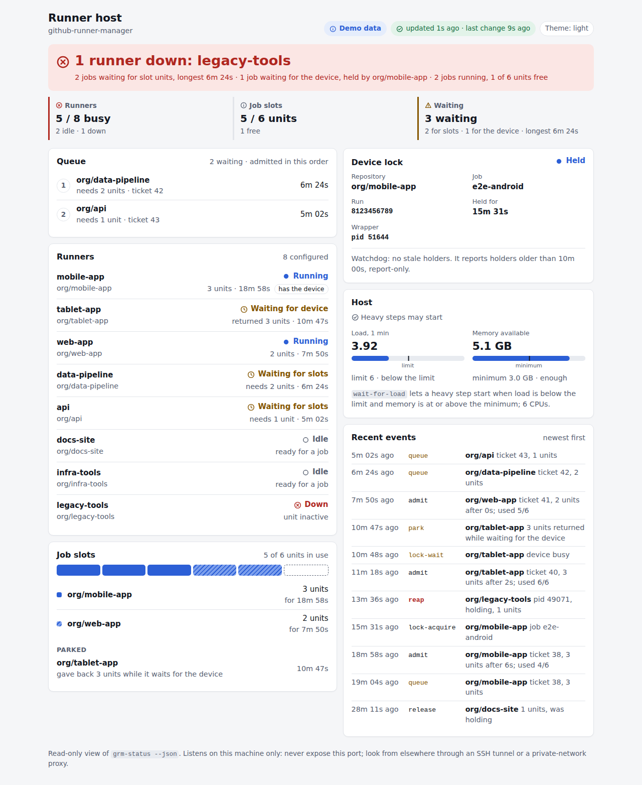
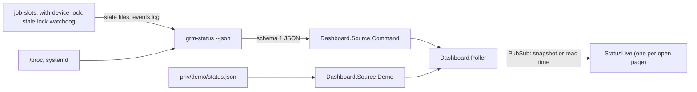
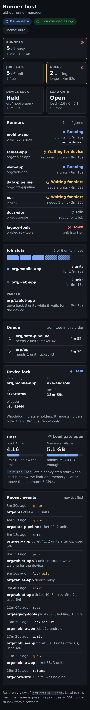
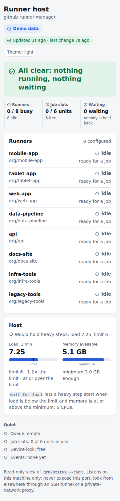

# Dashboard

A local, read-only web page that answers at a glance what the gates are doing:
which runners are up, busy or idle; how full the slot pool is and who holds how
many units; who is waiting, in admission order, and for how long; who has the
device lock, for how long, and whether the watchdog considers it stale; load and
memory against the gate thresholds; and the most recent events.



All data in the screenshots is the bundled demo reading, which is invented.

```bash
bin/grm-dashboard --demo      # invented data, nothing on the host is read
bin/grm-dashboard             # this host, through grm-status --json
bin/grm-dashboard --port 4300 # default port is 4290 (or GRM_DASHBOARD_PORT)
```

Then open <http://127.0.0.1:4290>. The first start fetches the Hex packages
(network) and compiles; later starts take a few seconds.

`GRM_STATUS_COMMAND` replaces `grm-status`: the path of one executable, run
with `--json` (no shell, no other arguments), that prints [schema 1](status-json.md).

## Cost, and the fallback

The dashboard is the one part of this toolkit that needs more than Bash: Erlang
and Elixir, at the versions in `dashboard/.tool-versions`. Nothing else depends
on it, and it changes no state. Without Elixir the same information is available
in the terminal:

```bash
bin/grm-status --watch   # the text view, repeated every 2 seconds
bin/grm-status --json    # the document the dashboard reads
```

## Security

Without a viewer list the dashboard asks no login, so it must stay local; with
one, served to a private network, only listed viewers see it, from anywhere.

- The endpoint binds 127.0.0.1 only; `bin/grm-dashboard` has no option to bind
  anything else. The one exception is the [hosted relay](relay.md) image,
  which shows only what the host pushes to it and asks for a password.
- **Never expose the port**: no port forward, no `0.0.0.0`, no public reverse
  proxy or tunnel. To look from another machine use an SSH tunnel, which keeps
  the request local on the host: `ssh -L 4290:127.0.0.1:4290 user@host`, then
  open `http://localhost:4290` on your side. To look from a phone, use a
  private-network proxy on the same machine: [remote-access.md](remote-access.md).
- Requests whose `Host` header is not `localhost` or `127.0.0.1` get a 403.
  Without that check, a web page open in a browser on the host could reach the
  loopback port through DNS rebinding.
- The WebSocket accepts pages from the same two names only (`check_origin`).
- More names can be allowed, exactly and one by one, with `--allow-host` or
  `GRM_DASHBOARD_ALLOWED_HOSTS`, for the private-network proxy above. One list
  (`DashboardWeb.AllowedHosts`) feeds the `Host` check, the socket origin check
  and the content security policy. Forwarded headers are never read.
- An extra name needs a viewer list (`--viewer` or `GRM_DASHBOARD_VIEWERS`):
  the identities the private-network proxy names in its identity header.
  Without one the dashboard refuses to start. With one, every request needs a
  listed identity, loopback ones included, and the live socket checks the
  signed session again when it connects. Details and limits, including what a
  process on this machine can still do:
  [remote-access.md](remote-access.md#viewers).
- At most 4 acceptors with 32 connections each; a phone and a laptop need a
  handful.
- The page is view-only by construction: it handles no events from the
  browser, has no forms and no parameters, and a test flags the usual ways
  that would change. A job's detail view is part of the rendered page and
  opens as a browser popover (`popovertarget`), so opening one sends nothing
  to the server. Its links go to the job's GitHub server only when every part
  has the exact shape GitHub gives it (owner/name, numeric run id, hex commit,
  an `http(s)` origin); they open in a new tab without a referrer.
  The status command is started with a fixed argument vector from
  configuration; nothing a request carries can reach it.
- In relay mode, and only there, one route takes input: `POST /ingest`, where
  the runner host pushes its status with a push token. A relay runs no status
  command. See [Relay mode](#relay-mode).
- A content security policy allows scripts and styles from the dashboard itself
  only, with no inline code. Values from the status document are escaped by the
  templates.
- It is read-only. `grm-status --json` creates no state, never probes the device
  lock, and never signals a process; the dashboard only runs that command.

What it shows is still information about the host (repository names, job names,
branches, pull request titles, who started a run, process ids), which is one
more reason to keep it local. Every job on the host
can read the same information directly while runners and the dashboard share
an account: see [runner-units.md](runner-units.md#separate-accounts).

## How it works



**The seam is `grm-status --json`** ([schema](status-json.md)). The dashboard
knows nothing about state files, locks or `/proc`; the Bash side knows nothing
about the dashboard. The schema is versioned and the Elixir side rejects a
version it does not know instead of guessing.

| Module | Job |
| --- | --- |
| `Dashboard.Source` | Behaviour for "read the host once". `Source.Command` runs the status command under `timeout`; `Source.Demo` replays the bundled reading; `Source.Relay` serves the last push (see [Relay mode](#relay-mode)). |
| `Dashboard.Status` | Parses the document into structs at the boundary. A wrong type or missing field is an error naming the field. Enumerated values map through explicit clauses; no atoms are created from input. |
| `Dashboard.Overview` | Pure functions for everything derived: runner activity, pool use, queue order, waits, lock condition, load gate, formatting. `now` is always an argument. |
| `Dashboard.Snapshot` | The latest reading plus whether reading currently fails, and since when. |
| `Dashboard.Poller` | The one long-lived process: owns the timer, the last good reading and the failure count. |
| `DashboardWeb.StatusLive` | Subscribes to the poller's topic; renders function components from `StatusComponents`. |

Supervision is `rest_for_one` in dependency order: PubSub, a task supervisor,
the poller, the endpoint. Each read runs as a supervised task, so a slow or
crashing status command neither blocks page loads nor takes the poller down.

**Refresh.** The poller reads every 2 seconds (`GRM_DASHBOARD_INTERVAL_MS`) and
broadcasts a snapshot when the picture differs from the previous one, ignoring
the document's own timestamp. An unchanged good reading sends only its read
time. Pages keep a one-second clock, so waits and hold times count up between
readings without a message from the gates. One reading serves every open page.

The header's "updated · last change" separates the last successful host read
from the last change to runners, slots, queue, lock or events. Load and memory
are sampled without moving the change time; failure or recovery to the same
picture does not move it either.

**When reading fails** the last good reading stays on screen; the verdict turns
to "Stale data", with its age and the read error. Retries back off
exponentially to 30 seconds and return to the normal interval on the first
success. If no reading has ever succeeded the page says so and shows no cards.
If the browser loses the dashboard itself, the page says it is disconnected.

**Demo mode** serves `dashboard/priv/demo/status.json` re-based to the current
time on a ten-minute loop, with a little drift in the load figure so the page
visibly updates. The same file is the fixture for the ExUnit tests, and a bats
test checks that it has exactly the shape real `--json` output has.

### Polling, not file watching

Watching the state directory looks cheaper but would miss most of what the page
shows. Load and memory come from `/proc`. Whether a holder is still alive is
process state: a crashed job changes no file until the next gate command reaps
it. Runner state is systemd's. Wait times change with the clock. A watcher would
therefore need a timer as well, plus a dependency and its platform quirks, to
save one short command every two seconds. Polling a single command also keeps
the seam in one place.

### Why LiveView

| Option | Trade-off |
| --- | --- |
| LiveView (chosen) | Server-rendered and pushed on change, so the page never shows a half-updated picture and needs no client code of its own. One read serves all pages. State parsing and derived values are plain, testable Elixir. Costs an Elixir toolchain on the host. |
| Static page polling the JSON | Smallest footprint and no toolchain, but still needs something to serve the JSON locally, moves all derivation into untested browser script, and each open page polls on its own. |
| Terminal UI | No browser needed; poor on a phone over a tunnel, and no better than `grm-status --watch`, which already exists. |
| Prometheus and Grafana | Right for history and alerting across hosts. Two more services to run and secure on a modest machine, and a queue in admission order or a lock holder is awkward as time series. |

### Dependencies

| Package | Why |
| --- | --- |
| `phoenix`, `phoenix_live_view`, `phoenix_html` | The web layer and its templates. |
| `bandit` | The HTTP server. |
| `jason` | JSON decoding. |
| `lazy_html` (tests only) | Required by `Phoenix.LiveViewTest`. |

There is no database, mailer, translation layer or asset pipeline. The
stylesheet is one hand-written file and the LiveView client is served as
shipped inside the Hex packages, so there is no Node, bundler or CSS toolchain
to install and nothing to download at build time beyond Hex packages.

## Reading the page

Every state has words and a shaped icon; colour reinforces it. Light and dark
follow the system setting; the header button overrides it.

- **Verdict**, first: red *attention* for down runners, no configured runners,
  jobs on unlisted runners, a stale lock or an unclaimed lock, in that order.
  Otherwise amber *waiting* for jobs queued or parked; otherwise green *all
  clear*, with the running count or "nothing running, nothing waiting".
  Details show slot waits, device waits, running jobs and any held heavy steps.
  A failed read replaces the verdict with the stale message.
- **Capacity strip**: runners busy and idle/down; slot units used/free; total
  waiting, split between slots and device, with the longest slot wait. Three
  cells stay across on a phone. Coloured edges and icons flag down runners,
  overcommit and waiting work.
- **Cards**: queue first, then runners and slots; device lock, host and events
  follow. Two columns on wide screens, one on a phone.
- **Runners**: *Running* (holding units or outside the slot gate), *Waiting for
  slots*, *Waiting for device* (parked, units returned), *Idle*, *Down* (unit
  not active). Jobs match runners through their worker process id.
- **Job slots**: one cell per unit while units are used. Hatched cells past
  capacity mean overcommit: an oversized job entered alone or a job passed
  the maximum wait. **Queue** lists admission order and wait times.
- **Job details**: every job the slot gate knows (in the queue, running,
  parked) opens a detail view from its row: tap or click anywhere on the row,
  or focus its name and press Enter. It is a drawer at the right on a wide
  screen and a sheet from the bottom on a phone; Escape, the Close button or a
  tap outside closes it. It shows the repository, workflow and job, the run, the
  pull request with its title when the run belongs to one, the branch, the
  short commit, event, actor, runner, units, what the job waits on and its place
  in the queue, when it reached the host, when it last got its units and how long it
  has been on the host. Run, pull request and commit link to the job's GitHub
  server (`GITHUB_SERVER_URL`). All of it comes from the
  [job record](job-slots.md#job-records) the start hook writes, through
  `grm-status --json`; the page fetches nothing. A job admitted before the
  hooks recorded jobs, or a field the record lacks, reads "unknown".
- **Device lock**: *Held* by a live wrapper; *Unclaimed* when its wrapper is
  gone; *Stale* when the watchdog reports a holder. The page never stops jobs.
- **Host**: "Heavy steps may start" when the gate is open; "Heavy steps are
  held" when closed while work runs or waits; "Would hold heavy steps" when
  idle. Only actual holding is amber: an idle host has no work to delay.
  Reasons name load/memory limits or missing readings. The meters label their
  threshold at mid-scale; load at or above its limit also shows the multiple.
- **Quiet**: empty queue, unused slots, free/absent device lock and empty events
  become muted rows below the cards, in that order. No empty cards or pool.
- **Freshness**: "updated" is the last successful read of the host; "last
  change" is when runners, slots, queue, lock or events last changed. A quiet
  host still updates; load/memory samples do not move the change time.


| Dark | Phone | Idle host, phone |
| --- | --- | --- |
|  |  |  |

The problem and idle shots use the other demo readings in `dashboard/priv/demo/`:
`GRM_DASHBOARD_DEMO_FILE="$PWD/dashboard/priv/demo/problems.json" bin/grm-dashboard --demo`
(or `idle.json`; the path must be absolute, since the server runs in `dashboard/`).

## Relay mode

A relay shows what a runner host pushes to it instead of reading a host. It is
the first step towards viewing the board from a phone without a private
network: the host sends its `grm-status --json` document out, and the relay,
which can never reach the host, serves the board from the last one it got.
Started by `bin/grm-dashboard` it listens on 127.0.0.1 like every other mode;
the [hosted relay](relay.md) is the same mode in a container on Fly.io, with
a viewer password and rate limits.
On the host, [`bin/grm-relay-push`](relay-push.md) sends the
`grm-status --json --public` document; the example below pushes the demo
document by hand.

```bash
token=$(openssl rand -hex 32)
GRM_RELAY_PUSH_TOKENS=$token bin/grm-dashboard --relay --port 4391 &
# Once it answers: a push carries one token; the relay may accept several
# (comma-separated).
curl --config <(printf 'header = "Authorization: Bearer %s"\n' "$token") \
  --data-binary @dashboard/priv/demo/status.json http://127.0.0.1:4391/ingest
# {"next_push_seconds":5}
```

- `POST /ingest` is the one route that takes input, and exists only in relay
  mode (any other mode answers 404). It has its own pipeline: no session, no
  CSRF token, no HTML.
- A push needs `Authorization: Bearer <token>` with one of the tokens in
  `GRM_RELAY_PUSH_TOKENS`, each 32 or more visible characters, compared in
  constant time. Several tokens let a new one overlap the old while rotating.
  Tokens come from the environment only, never from the command line.
- The body is read only after the token passed, and at most 128 KB of it
  (413 above that). It must be a schema 1 document; the same parser as every
  other mode reads it (422 otherwise). A document generated before the last
  accepted one is refused (409), unless the last push is over ten minutes old,
  which reads as the host's clock having stepped back.
- The reply to a good push is `{"next_push_seconds": N}`, N from
  `GRM_RELAY_INTERVAL_SECONDS` (default 5, 2 to 900). Refusals name their
  reason and echo nothing that was sent.
- The latest push is kept in memory only (`Dashboard.Relay.Inbox`); a restart
  empties it until the next push. The page reads it every second
  (`GRM_DASHBOARD_INTERVAL_MS` does not apply), and "updated" is when the push
  arrived.
- After three missed pushes, and at least 30 seconds, the board keeps the last
  picture and turns to "Stale data": the relay cannot reach the host, it can
  only wait. Before the first push the page says no report has arrived.

- With `GRM_RELAY_VIEWER_PASSWORD` set, the page asks for that password too,
  on loopback as on the hosted relay, and wrong passwords and tokens are
  rate-limited ([hosted relay](relay.md#security)).

The relay modules: `Dashboard.Relay` (settings, staleness), `Dashboard.Relay.Ingest`
(token and order decisions, pure), `Dashboard.Relay.Inbox`, `Dashboard.Source.Relay`,
`DashboardWeb.IngestController`, and for the viewer password and rate limits
`DashboardWeb.RelayLogin`, `DashboardWeb.Plugs.RelayLogin`,
`Dashboard.Relay.Throttle` and `Dashboard.Relay.Limiter`.

## Running it permanently

`systemd/grm-dashboard.service.in` is a template for a systemd user unit; the
comment at its top has the commands. Nothing installs it for you. The service
runs a built release, never the source: build it once, and again after each
update of the checkout:

```bash
cd dashboard && mix deps.get --only prod && MIX_ENV=prod mix release
```

The unit sets `GRM_DASHBOARD_RELEASE_ONLY=1`, which makes the launcher stop
with a message instead of fetching packages over the network and compiling
whatever is in the checkout at each start. The unit also caps memory and
tasks; a user unit's caps take effect only where the user manager has the
`memory` and `pids` controllers delegated (cgroup v2), and are ignored
otherwise. Check with
`cat /sys/fs/cgroup/user.slice/user-$(id -u).slice/user@$(id -u).service/cgroup.controllers`.
A built release always wins over the source for `bin/grm-dashboard` run
by hand too, but the launcher refuses one older than any file in the source
(`lib`, `config`, `assets`, `priv`, `mix.exs`, `mix.lock`), so a forgotten
rebuild stops the start instead of running old code. If the checkout path contains spaces, quote it in the unit's
`ExecStart`.

## Development

```bash
cd dashboard
mix deps.get
mix check          # format check, compile with warnings as errors, tests
```

`test/dashboard.bats` covers the launcher without Elixir.
`test/dashboard-smoke.bats` starts the real server in demo mode and checks that
it listens on 127.0.0.1 only, serves the page, refuses path traversal and
foreign `Host` headers, answers to one extra allowed name, completes a WebSocket
handshake for allowed origins only, and exits on TERM. It also starts relay
mode and checks that a push is kept with the token only and then shown. Both
are skipped where Elixir is absent.

## Not verified

The dashboard has been exercised with demo data, with stubbed status commands,
and against `grm-status --json` under the bats suite's stubs. It has not been
run against a host with real runners, real systemd units or a real device lock,
nor for days at a time.
