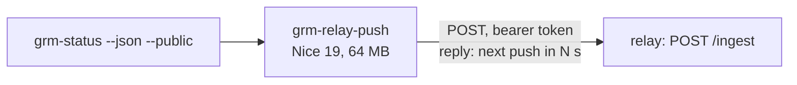

# Relay push

`bin/grm-relay-push` sends this host's status to a relay (the dashboard in
[relay mode](dashboard.md#relay-mode-loopback-only-for-now)) every few
seconds. The host only makes outbound requests: nothing listens, and the
relay's reply sets the next push time and nothing else. It is in no job's
path and writes no gate state.



## What it sends

`grm-status --json --public`: the same document, with names replaced by
aliases (`runner-1`, `repo-1`) and no job details, paths, runner labels or
user names ([public output](status-json.md#public-output)). Set
`GRM_RELAY_SHARE_DETAILS=1` in the config to send real repository and runner
names and the job details, so the relay's board links each job to its run and
pull request. Paths, runner labels and user names stay out either way.

## Settings

| Setting | Default | Meaning |
| --- | --- | --- |
| `GRM_RELAY_URL` | none | The relay's `/ingest` URL. `https://` only; `http://` to `127.0.0.1` or `[::1]` for a relay on this machine. |
| `GRM_RELAY_TOKEN_FILE` | `$XDG_CONFIG_HOME/grm/relay-token` (`~/.config/grm/relay-token`) | The push token: one line, 32 or more visible characters, no quotes or backslashes, in a file only this account can read (`chmod 600`). Read before every push, so a rotated token needs no restart. |
| `GRM_RELAY_SHARE_DETAILS` | `0` | `1` sends real names and job details (above). |

## Behaviour

- One push: `grm-status --json --public` (60 s limit, 128 KB cap), then one
  `curl` POST with a 15 s limit. The token reaches `curl` through a config on
  a file descriptor, never on a command line. `curl` may use only the URL's
  protocol, reads no `~/.curlrc`, and reaches a loopback relay without a proxy.
- The reply's `next_push_seconds` sets the wait, clamped to 2 to 300 seconds
  (the relay accepts intervals up to 900; the pusher's 300 wins); without it
  the wait is 5.
- A failure (no token, status failed, curl error, any status but 200) backs off:
  twice the interval, doubling up to 5 minutes, less up to a quarter at random.
- It logs the first failure of a run and the recovery, nothing else.
- `--once` pushes once, prints `grm-relay-push: pushed` or the reason, and
  exits 0 or 1. A bad URL or token file exits 2 before anything is sent.

## Trying it on this machine

```bash
token=$(openssl rand -hex 32)
GRM_RELAY_PUSH_TOKENS=$token bin/grm-dashboard --relay --port 4391 &
(umask 077; mkdir -p ~/.config/grm; printf '%s\n' "$token" > ~/.config/grm/relay-token)
GRM_RELAY_URL=http://127.0.0.1:4391/ingest bin/grm-relay-push --once
# grm-relay-push: pushed; open http://127.0.0.1:4391
```

## Running it permanently

`systemd/grm-relay-push.service.in` is a user unit template: lowest CPU and
I/O priority, 64 MB memory cap, restarted a minute after a failure. Set the
URL in the config and the token file first, check with `--once`, then follow
the steps in the template's header. The token and URL never go in the unit.
