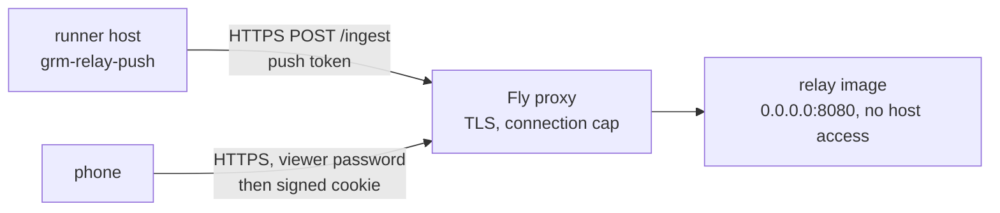

# Hosted relay

The hosted relay is the dashboard in [relay mode](dashboard.md#relay-mode)
on the internet, so a phone can see the board without a private network. The
runner host pushes its public status out ([`bin/grm-relay-push`](relay-push.md));
the relay never reaches the host. `dashboard/Dockerfile` builds it and
`dashboard/fly.toml.example` runs it on Fly.io: one small machine that sleeps
when idle.



This is the only mode that listens beyond loopback. `bin/grm-dashboard`
refuses `GRM_RELAY_PUBLIC_HOST`, so a dashboard on the runner host never does.

## Settings

The image sets `GRM_DASHBOARD_SOURCE=relay`, `PORT=8080` and
`PHX_SERVER=true`. The rest comes from `fly.toml` (`GRM_RELAY_PUBLIC_HOST`)
and from Fly secrets (the other three).

| Setting | Meaning |
| --- | --- |
| `GRM_RELAY_PUBLIC_HOST` | The relay's public name, e.g. `<your-app-name>.fly.dev`. Turns on the public bind (0.0.0.0), HSTS, `X-Robots-Tag: noindex` and `Fly-Client-IP`. Relay mode only; the server refuses to boot with it in any other mode. |
| `GRM_RELAY_VIEWER_PASSWORD` | The password the browser asks for: 16 or more visible characters. Required with a public name; optional on loopback. |
| `GRM_RELAY_PUSH_TOKENS` | As in [relay mode](dashboard.md#relay-mode): 32 or more characters each, comma-separated to rotate. |
| `SECRET_KEY_BASE` | Signs the session cookie. Required with a public name, 64 or more characters, so a sign-in outlives a restart. |

## Security

- **Viewer password.** The browser's own password prompt (HTTP basic
  authentication over Fly's TLS); the user name is ignored. A right password
  is recorded in the signed session cookie (`Secure`, `HttpOnly`,
  `SameSite=Strict`, 12 hours), which the live socket checks again when it
  connects. The cookie holds a keyed digest of the password, never the
  password, so a new password or `SECRET_KEY_BASE` ends every session.
- **Push token.** Unchanged from relay mode: compared in constant time against
  every configured token, before the body is read; body capped at 128 KB.
- **Comparisons** of passwords and tokens hash both sides and compare the
  digests in constant time.
- **Rate limits** (`Dashboard.Relay.Throttle`), counted per client: the IPv4
  address, or the IPv6 /64.
  - Ten wrong viewer passwords or push tokens within ten minutes lock that
    client out for ten minutes (429 with `Retry-After`), before anything is
    compared. A right one is not counted, so a browser resending the password
    or a host pushing every few seconds is never locked out.
  - A hundred wrong attempts within an hour, from all clients together, refuse
    every new attempt until the hour has passed. A viewer already signed in
    keeps the board.
  - One accepted push a second.
  - Fly's proxy caps connections at 25 per machine (`fly.toml.example`).
- **Client address.** `Fly-Client-IP`, read with a public name only; anywhere
  else anyone could send it. Without a usable one the connection's address is
  used, which behind Fly is the proxy's, so all such requests share one key.
- **Headers.** HSTS for a year, `X-Robots-Tag: noindex, nofollow` and the
  dashboard's existing CSP, `Referrer-Policy: no-referrer` and `Host` check.
  `/robots.txt` is answered under any `Host`, for Fly's health check.
- **Nothing secret in logs.** Request logs carry no headers; tests check that
  neither the password nor a token reaches the log.
- **The container** runs as an unprivileged user, cannot write its own
  release, and starts no Erlang distribution, so only port 8080 listens.

## Deploying to Fly.io

Steps only the owner can do: they need a Fly account, cost money and create
secrets. Run them from a checkout of this repository on any machine with
[`flyctl`](https://fly.io/docs/flyctl/install/) and `openssl`, apart from steps
8 to 10, which run on the runner host.

1. Update the checkout and enter the dashboard directory:

   ```bash
   git pull && cd dashboard
   ```

2. Sign in and pick a region close to the phone:

   ```bash
   fly auth login
   fly platform regions
   ```

3. Make the app's config from the template, with your app name and region:

   ```bash
   app=<your-app-name> region=<region>
   sed -e "s/<your-app-name>/$app/g" -e "s/<region>/$region/" fly.toml.example > fly.toml
   ```

   `fly.toml` is not tracked; keep it beside the template.

4. Create the app (no machine yet):

   ```bash
   fly apps create "$app"
   ```

5. Make the secrets and store them on Fly. Keep the password in a password
   manager; the token goes to the runner host in step 8.

   ```bash
   token=$(openssl rand -hex 32)
   password=$(openssl rand -base64 24)
   printf 'GRM_RELAY_PUSH_TOKENS=%s\nGRM_RELAY_VIEWER_PASSWORD=%s\nSECRET_KEY_BASE=%s\n' \
     "$token" "$password" "$(openssl rand -base64 48)" | fly secrets import
   printf 'viewer password: %s\npush token: %s\n' "$password" "$token"
   ```

6. Deploy one machine and check it:

   ```bash
   fly deploy --ha=false
   fly status
   ```

   `fly status` should list one machine.

7. Check from outside: the health file answers, the board asks for the
   password.

   ```bash
   curl -sS "https://$app.fly.dev/robots.txt"
   curl -sS -o /dev/null -w '%{http_code}\n' "https://$app.fly.dev/"   # 401
   ```

8. On the runner host, as the runners' account, in its checkout: store the
   token from step 5 and point the pusher at the relay.

   ```bash
   (umask 077; mkdir -p ~/.config/grm; printf '%s\n' '<push token>' > ~/.config/grm/relay-token)
   printf 'GRM_RELAY_URL=https://%s.fly.dev/ingest\n' '<your-app-name>' >> config.env
   ```

9. Push once:

   ```bash
   bin/grm-relay-push --once   # grm-relay-push: pushed
   ```

10. Install the pusher's user unit: follow the header of
    `systemd/grm-relay-push.service.in`.

11. On the phone, open `https://<your-app-name>.fly.dev`, enter the viewer
    password (any user name) and add the page to the home screen.

### Later

- New viewer password (ends every session):
  `fly secrets set GRM_RELAY_VIEWER_PASSWORD="$(openssl rand -base64 24)"`.
- New push token without a gap: set both, update the host's token file, then
  drop the old one:
  `fly secrets set GRM_RELAY_PUSH_TOKENS="$new,$old"`, then
  `fly secrets set GRM_RELAY_PUSH_TOKENS="$new"`.
- Take it down: `fly apps destroy <your-app-name>`, then remove
  `GRM_RELAY_URL` from the host's `config.env` and stop the unit.

## Trying the image locally

```bash
docker build -t grm-relay dashboard
GRM_RELAY_IMAGE=grm-relay test/vendor/bats-core/bin/bats test/relay-image.bats
```

`test/relay-image.bats` runs the image published on 127.0.0.1 only, under a
public name, and checks the health file, the password prompt, a push, the
lockout, the headers, the logs, the user and the listening ports. CI builds
the image and runs it on every pull request; nothing pushes or deploys it.

## Not verified

None of this has run on Fly. In particular:

- Whether Fly's proxy replaces a `Fly-Client-IP` header a client sends. If it
  passes one through, a client could spread its guesses over many keys; the
  global cap of a hundred an hour still holds.
- Which `Host` Fly's health check sends (the `/robots.txt` exemption covers
  any), and whether the checks wake or keep awake a suspended machine.
- That a suspended machine resumes with its last push and its rate-limit
  counts; a stopped one starts empty, and the board waits for the next push.
- Slow-request resistance rests on Fly's proxy and the connection cap.
