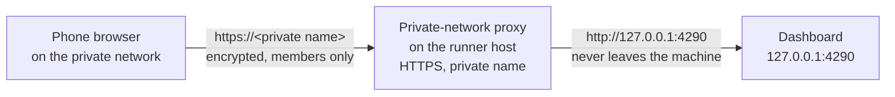

# Looking at the dashboard from a phone

The [dashboard](dashboard.md) listens on 127.0.0.1 and, until you list
viewers, asks no login of a browser on the same machine. To see it from a phone, put a **private-network
proxy on the same machine** in front of it: software that gives your own
devices a private network, can serve a loopback port to them under a private
HTTPS name, and adds a header naming the signed-in user to each request. The
dashboard then shows the page only to the users you list.



Nothing about the dashboard's listening address changes. It needs to be told
two things: the private name, because it refuses requests and live-socket
connections made under any name it does not know (the defence against DNS
rebinding described in [dashboard.md](dashboard.md#security)), and who may
look.

## The setting

```bash
bin/grm-dashboard --allow-host <private-name> --viewer <your-login>
# or, for a service:
#   GRM_DASHBOARD_ALLOWED_HOSTS=<private-name>[,<another>]
#   GRM_DASHBOARD_VIEWERS=<your-login>[,<another>]
```

- Names are matched exactly and case-insensitively. No wildcards, no suffix
  matching, no ports, no URLs: a value that is not a plain host name stops the
  start with a message.
- The default is unchanged: `localhost` and `127.0.0.1` only.
- A listed name is accepted in three places, all fed from the one list: the
  `Host` header, the `Origin` of the live WebSocket, and the page's content
  security policy (as `wss://<private-name>:*`).
- `X-Forwarded-Host`, `Forwarded` and similar headers are not read. The checks
  use only what the browser sends: `Host` and `Origin`.
- **The proxy must pass the browser's `Host` header through unchanged**, and
  should serve HTTPS. A proxy that rewrites `Host` to a loopback name makes
  every request look local, which switches off the DNS-rebinding check for
  pages reached through it; over plain HTTP nothing else stands in for it.
- The WebSocket address is derived from the page's own address by the browser,
  so behind an HTTPS proxy it is `wss://` with no further setting.

### Viewers

- An allowed host with no viewer list stops the start, in the launcher and in
  the dashboard itself. There is no switch to serve the page under another
  name without a list.
- Viewers are identities as the proxy writes them in its identity header,
  matched exactly and case-insensitively. The header is
  `Tailscale-User-Login` unless `GRM_DASHBOARD_VIEWER_HEADER` names another.
- With a viewer list, every request needs exactly one identity header naming a
  listed viewer, requests to `localhost` included. No header, an unlisted
  identity, or two headers: 403 with no data, and the session cookie is
  dropped. A loopback `Host` proves nothing: any forwarder that adds no header
  of its own (a TCP-mode proxy, an SSH tunnel) passes the client's `Host`
  through, so the dashboard makes no exception for it.
- So a dashboard with viewers is no longer viewable in a browser on the host
  or through an SSH tunnel. For that, use `grm-status --watch`, or start a
  second dashboard on another port with no allowed host and no viewers
  (`bin/grm-dashboard --port 4291`).
- The live socket does not pass through the request check, so the page checks
  again when it connects: the signed session must name a listed viewer seen
  within the last 12 hours. Otherwise the page reloads and the request check
  answers.
- With a viewer list the session cookie is `Secure`, `SameSite=Strict`,
  `HttpOnly`, and expires after 12 hours. Unless `SECRET_KEY_BASE` is set, the
  signing secret is new on every start, so a restart signs everyone out. Do not
  set it in the unit: jobs under the same account can read a unit's
  environment.

## Example: Tailscale

[Tailscale](https://tailscale.com) is one such private network; its `serve`
command is the proxy. The commands below follow its documentation
([Serve](https://tailscale.com/kb/1312/serve),
[`tailscale serve` reference](https://tailscale.com/kb/1242/tailscale-serve),
[HTTPS certificates](https://tailscale.com/kb/1153/enabling-https)) as read on
2026-11-15; check there if a command is refused.

Once, for the whole network: in the admin console's DNS page, turn on MagicDNS
and, under HTTPS Certificates, enable HTTPS. Note what that page warns about:
machine names and the network's DNS name are then published in the public
certificate-transparency ledger, so rename a machine first if its name says
something you would not publish.

Then, with the client installed and signed in on the runner host and on the
phone:

```bash
# 1. On the runner host: find its private name (the "DNSName", without the
#    trailing dot), of the form <machine>.<tailnet>.ts.net
tailscale status --json | grep -m1 DNSName

# 2. Find your login name as the network shows it, e.g. you@example.com
tailscale status --json | grep -m1 LoginName

# 3. Start the dashboard, allowing that name and that viewer
bin/grm-dashboard --allow-host <machine>.<tailnet>.ts.net --viewer <login-name>

# 4. Serve the loopback port to the private network, over HTTPS on port 443,
#    in the background (kept across restarts until turned off)
tailscale serve --bg 4290

# 5. Check what is served, and that it is private
tailscale serve status
```

Open `https://<machine>.<tailnet>.ts.net` on the phone, with the phone connected
to the same private network.

**Linux host.** Run the commands as above on the host. `tailscale serve` may need
`sudo`, or a one-time `sudo tailscale set --operator=$USER`.

**Runners inside a virtual machine or a Linux subsystem.** When the runners and
the dashboard live in a guest and the private-network client is installed on
the machine that hosts it, run steps 1, 2, 4 and 5 on the host and step 3 in
the guest. The proxy forwards to `127.0.0.1:4290` on the host, so the host must be
able to reach the guest's loopback port there. Check that leg on its own, from
the host, before involving the phone: `curl http://127.0.0.1:4290/robots.txt`
should print two lines. If it does not, the guest's port forwarding is the
thing to look at, not the dashboard. Note what that forwarding means: every
process and every user on the host machine can open the port and send any
identity header, so the viewer check does not keep them out (see below). That
`curl` answers 403 for the page itself unless it sends a listed identity.

**Private, not public.** `tailscale serve` shares with the private network only.
A different command, `tailscale funnel`, publishes a port to the whole internet:
never use it for this dashboard. Funnel requests carry no identity header, so
the viewer check refuses them, but the page should not be published at all.
`tailscale serve status` shows which of the two applies to each address.

## Keeping it running

Use the unit template in [`systemd/grm-dashboard.service.in`](../systemd/grm-dashboard.service.in)
(see [dashboard.md](dashboard.md#running-it-permanently)) and uncomment its
`GRM_DASHBOARD_ALLOWED_HOSTS` and `GRM_DASHBOARD_VIEWERS` lines with your private
name and login. The proxy keeps its
own configuration: with `--bg`, Tailscale restores the served port after a
restart by itself.

## What is exposed, and to whom

- **To whom:** the viewers you list, on any device the private network lets
  reach the runner host on the served port. Other members of the network,
  devices shared into it, and tagged devices (which carry no user identity)
  get a 403. Restrict access in the network's own rules as well: that layer
  stops other devices before they reach the machine at all.
- **What they see:** everything on the page: runner names, repository names,
  job labels, process ids, load and memory, lock holders and recent events.
- **What they can do:** look. The page takes no input: no buttons that reach
  the server, no forms, no parameters, and one route that only reads. A test
  (`dashboard/test/dashboard_web/view_only_test.exs`) flags the usual ways an
  event handler or a form would be added to the web layer; it is a tripwire
  for review, not a proof.
- **What is not exposed:** the port to the local network or the internet. The
  dashboard still binds 127.0.0.1; only the proxy, on the same machine, talks
  to it. Other machines cannot reach the port directly, and a request that
  arrives under a name that is not listed is refused.

## What the viewer check does not stop

The check trusts the identity header, so it is as strong as the proxy's
handling of it.

- **The proxy must remove any copy of the identity header a client sends.**
  Tailscale Serve in its HTTP and HTTPS modes does, by its documentation; a
  different proxy must be checked or configured to. **Never use a TCP-mode
  forwarder** (`tailscale serve --tcp` or `--tls-terminated-tcp`, `socat`,
  `ssh -R`): it passes a client's own identity header straight through, and
  any member of the network can claim to be a listed viewer.
- **Anything on this machine can forge it.** A process that reaches
  127.0.0.1 directly, such as a workflow job running on the same host, can send
  any header, a listed identity included. It can also read the status files and
  run `grm-status --json` itself. The viewer check keeps other devices and
  people out; it is no defence against code running on the host. Running
  runners under accounts of their own is: see
  [runner-units.md](runner-units.md#separate-accounts).
- **Check it once from the network.** From a device whose user is not listed
  (or with your login removed from the list for a moment), both of these must
  answer 403: opening the page, and
  `curl -s -o /dev/null -w '%{http_code}' -H 'Tailscale-User-Login: <a listed login>' https://<private-name>/`,
  which shows the proxy replaces a client's identity header.
- **Another process can take the port while the dashboard is down.** The proxy
  forwards to whatever listens on 127.0.0.1:4290. During a restart, or after
  something on the host stops the dashboard, a local process can listen there
  and its page is served under the trusted private name, receiving the
  viewer's identity header and session cookie (good for 12 hours against the
  real dashboard, until it restarts). Only code already running on the host
  can do this; run the dashboard under an account jobs cannot reach (see
  above) and keep it running. A listener the dashboard owns for its whole life
  (a systemd socket unit, or a Unix socket in a private directory) would close
  this; neither is supported yet.

## Turning it off

```bash
tailscale serve reset   # stop serving (clears the whole serve configuration)
```

That closes the path from the phone. Then restart the dashboard without
`--allow-host` (or with the variable removed), which returns it to answering
loopback names only.

## Alternatives considered

- **A hosted copy fed by snapshots.** The dashboard would run at a hosting
  provider and the runner host would push its status out to it. That needs an
  ingest endpoint, two secrets, a public login page and a paid machine, and it
  puts repository and job names on someone else's server. More to build and
  more to defend, for the same picture.
- **A public tunnel with a login in front.** Simple to start, but the page is
  then one password or one misconfiguration away from the internet, and the
  login is a third party's.
- **A shared token exchanged for a cookie.** Works with any proxy, but adds the
  first route that takes input, needs rate limiting, and the token would sit in
  a file that jobs on the host can read. The proxy already knows who is asking;
  the viewer list reuses that.
- **An SSH tunnel** (`ssh -L 4290:127.0.0.1:4290 user@host`) remains the
  zero-setup way from a laptop; it is awkward on a phone.

A private network is the default recommendation because nothing becomes public
at any point, the dashboard keeps its loopback binding, and the application
needs only a list of names it answers to and of people who may look.

## Not verified

The application side is covered by this repository's tests: the `Host` check,
the socket origin check (including a real WebSocket handshake against a running
server), the viewer check on requests and on the live socket, the boot refusal,
the policy header and the launcher flags. Beyond the tests, a browser
loading the page under an extra allowed name mapped to loopback gets the page
and a connected live socket, and a 403 under a name that is not listed; that
was checked over plain HTTP, without a proxy.

The proxy side is outside what this repository can test. The Tailscale
commands, the HTTPS leg, the identity header (that the proxy adds it, removes
a client's copy, keeps `Host` and omits the header for tagged devices and
Funnel) and host-to-guest forwarding are described from their vendors'
documentation on the date above and have not been run as part of this
project.
