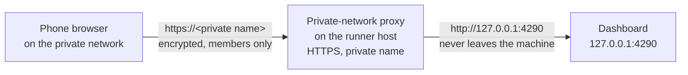

# Looking at the dashboard from a phone

The [dashboard](dashboard.md) listens on 127.0.0.1 and has no login. To see it
from a phone without changing either fact, put a **private-network proxy on the
same machine** in front of it: software that gives your own devices a private
network, and can serve a loopback port to them under a private HTTPS name.



Nothing about the dashboard's listening address changes. The one thing it needs
to be told is the private name, because it refuses requests and live-socket
connections made under any name it does not know (the defence against DNS
rebinding described in [dashboard.md](dashboard.md#security)).

## The setting

```bash
bin/grm-dashboard --allow-host <private-name>
# or, for a service: GRM_DASHBOARD_ALLOWED_HOSTS=<private-name>[,<another>]
```

- Names are matched exactly and case-insensitively. No wildcards, no suffix
  matching, no ports, no URLs: a value that is not a plain host name stops the
  start with a message.
- The default is unchanged: `localhost` and `127.0.0.1` only.
- A listed name is accepted in three places, all fed from the one list: the
  `Host` header, the `Origin` of the live WebSocket, and the page's content
  security policy (as `wss://<private-name>:*`).
- `X-Forwarded-Host`, `Forwarded` and similar headers are not read. The checks
  use only what the browser sends: `Host` and `Origin`.
- **The proxy must pass the browser's `Host` header through unchanged**, and
  should serve HTTPS. A proxy that rewrites `Host` to a loopback name makes
  every request look local, which switches off the DNS-rebinding check for
  pages reached through it; over plain HTTP nothing else stands in for it.
- The WebSocket address is derived from the page's own address by the browser,
  so behind an HTTPS proxy it is `wss://` with no further setting.

## Example: Tailscale

[Tailscale](https://tailscale.com) is one such private network; its `serve`
command is the proxy. The commands below follow its documentation
([Serve](https://tailscale.com/kb/1312/serve),
[`tailscale serve` reference](https://tailscale.com/kb/1242/tailscale-serve),
[HTTPS certificates](https://tailscale.com/kb/1153/enabling-https)) as read on
2026-11-15; check there if a command is refused.

Once, for the whole network: in the admin console's DNS page, turn on MagicDNS
and, under HTTPS Certificates, enable HTTPS. Note what that page warns about:
machine names and the network's DNS name are then published in the public
certificate-transparency ledger, so rename a machine first if its name says
something you would not publish.

Then, with the client installed and signed in on the runner host and on the
phone:

```bash
# 1. On the runner host: find its private name (the "DNSName", without the
#    trailing dot), of the form <machine>.<tailnet>.ts.net
tailscale status --json | grep -m1 DNSName

# 2. Start the dashboard, allowing that name
bin/grm-dashboard --allow-host <machine>.<tailnet>.ts.net

# 3. Serve the loopback port to the private network, over HTTPS on port 443,
#    in the background (kept across restarts until turned off)
tailscale serve --bg 4290

# 4. Check what is served, and that it is private
tailscale serve status
```

Open `https://<machine>.<tailnet>.ts.net` on the phone, with the phone connected
to the same private network.

**Linux host.** Run the commands as above on the host. `tailscale serve` may need
`sudo`, or a one-time `sudo tailscale set --operator=$USER`.

**Runners inside a virtual machine or a Linux subsystem.** When the runners and
the dashboard live in a guest and the private-network client is installed on
the machine that hosts it, run steps 1, 3 and 4 on the host and step 2 in the
guest. The proxy forwards to `127.0.0.1:4290` on the host, so the host must be
able to reach the guest's loopback port there. Check that leg on its own, from
the host, before involving the phone: `curl http://127.0.0.1:4290/robots.txt`
should print two lines. If it does not, the guest's port forwarding is the
thing to look at, not the dashboard.

**Private, not public.** `tailscale serve` shares with the private network only.
A different command, `tailscale funnel`, publishes a port to the whole internet:
never use it for this dashboard, which has no login. `tailscale serve status`
shows which of the two applies to each address.

## Keeping it running

Use the unit template in [`systemd/grm-dashboard.service.in`](../systemd/grm-dashboard.service.in)
(see [dashboard.md](dashboard.md#running-it-permanently)) and uncomment its
`GRM_DASHBOARD_ALLOWED_HOSTS` line with your private name. The proxy keeps its
own configuration: with `--bg`, Tailscale restores the served port after a
restart by itself.

## What is exposed, and to whom

- **To whom:** every device and person the private network lets reach the
  runner host on the served port. In a network of only your own devices that is
  you; if the network has other members, or the machine is shared with someone,
  its access rules decide. The dashboard itself asks for no password: the
  private network is the login.
- **What they see:** everything on the page: runner names, repository names,
  job labels, process ids, load and memory, lock holders and recent events.
- **What they can do:** look. The page takes no input: no buttons that reach
  the server, no forms, no parameters, and one route that only reads. A test
  (`dashboard/test/dashboard_web/view_only_test.exs`) flags the usual ways an
  event handler or a form would be added to the web layer; it is a tripwire
  for review, not a proof.
- **What is not exposed:** the port to the local network or the internet. The
  dashboard still binds 127.0.0.1; only the proxy, on the same machine, talks
  to it. Other machines cannot reach the port directly, and a request that
  arrives under a name that is not listed is refused.
- The proxy adds headers naming the signed-in user to each request. The
  dashboard ignores them.

## Turning it off

```bash
tailscale serve reset   # stop serving (clears the whole serve configuration)
```

That closes the path from the phone. Then restart the dashboard without
`--allow-host` (or with the variable removed), which returns it to answering
loopback names only.

## Alternatives considered

- **A hosted copy fed by snapshots.** The dashboard would run at a hosting
  provider and the runner host would push its status out to it. That needs an
  ingest endpoint, two secrets, a public login page and a paid machine, and it
  puts repository and job names on someone else's server. More to build and
  more to defend, for the same picture.
- **A public tunnel with a login in front.** Simple to start, but the page is
  then one password or one misconfiguration away from the internet, and the
  login is a third party's.
- **An SSH tunnel** (`ssh -L 4290:127.0.0.1:4290 user@host`) remains the
  zero-setup way from a laptop; it is awkward on a phone.

A private network is the default recommendation because nothing becomes public
at any point, the dashboard keeps its loopback binding, and the only change to
the application is a list of names it answers to.

## Not verified

The application side is covered by this repository's tests: the `Host` check,
the socket origin check (including a real WebSocket handshake against a running
server), the policy header and the launcher flag. Beyond the tests, a browser
loading the page under an extra allowed name mapped to loopback gets the page
and a connected live socket, and a 403 under a name that is not listed; that
was checked over plain HTTP, without a proxy.

The proxy side is outside what this repository can test. The Tailscale
commands, the HTTPS leg and host-to-guest forwarding are described from
their vendors' documentation on the date above and have not been run as part
of this project.
